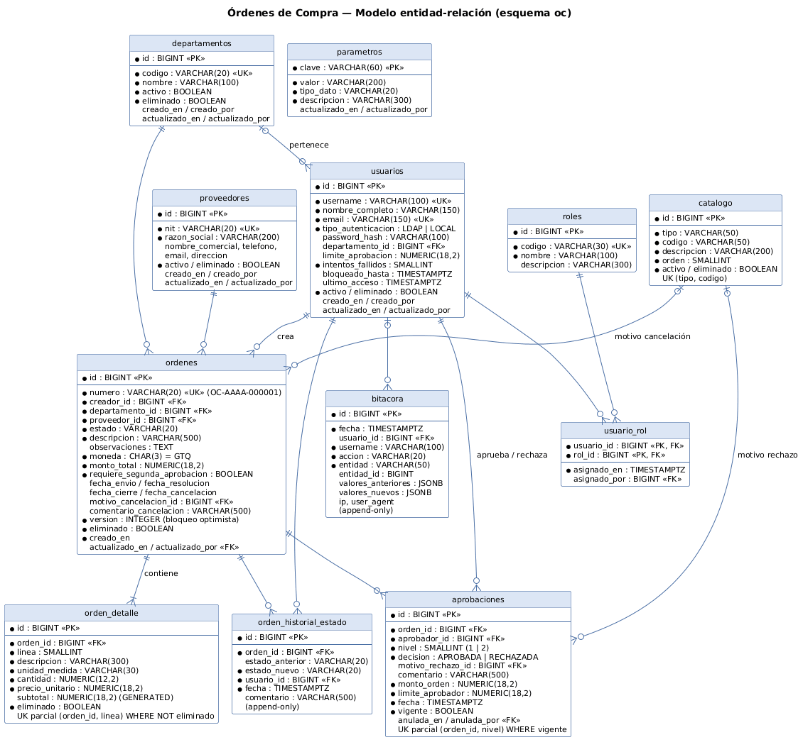

# Órdenes de Compra - diseconstech

Aplicación web para registrar, aprobar y dar seguimiento a órdenes de compra, con aprobación por límites (uno o dos niveles), auditoría completa y reportes exportables a PDF.

> **La primera carga puede tardar aprox. 1 min (hosting gratuito de Render).** El servidor se duerme tras un rato sin uso y tarda en despertar; después responde con normalidad.

- **Aplicación:** https://ordenes-compra.onrender.com
- **API (salud):** https://ordenes-compra-api-x7oq.onrender.com/actuator/health
- **Diagrama ER:** [docs/diagrama-er.png](docs/diagrama-er.png)

## Usuarios de demostración

Contraseña de todos: **`Demo2026!`**

| Usuario | Tipo | Autenticación | Roles | Límite de aprobación |
|---|---|---|---|---|
| `jmorales` | Interno | LDAP corporativo | ADMIN | - |
| `lgarcia` | Interno | LDAP corporativo | APROBADOR | Q 10,000.00 |
| `mperez` | Interno | LDAP corporativo | APROBADOR | Q 50,000.00 |
| `rlopez` | Interno | LDAP corporativo | ADMIN + APROBADOR | Q 100,000.00 |
| `cramirez` | Externo (asesor) | Usuario de la app (BCrypt) | EXTERNO | - |
| `asandoval` | Externo (asesor) | Usuario de la app (BCrypt) | EXTERNO | - |

**Para ver la doble aprobación:** entra como `cramirez`, crea una orden de Q 30,000 y envíala. `lgarcia` la aprueba, pero su límite es Q 10,000, así que la orden sigue pendiente de un segundo nivel. Ese segundo nivel lo da `mperez` o `rlopez`.

Las cuentas externas se bloquean 15 minutos después de 5 intentos fallidos.

## Funcionalidad

- **Perfiles y permisos (RBAC).** Los internos ven todas las órdenes. Los externos solo ven las suyas, y eso lo filtra el **servidor**: si un externo pide una orden ajena, recibe 404.
- **Ciclo de vida:** pasa de Borrador a Pendiente de aprobación, de ahí a Aprobada o Rechazada, y luego a Cerrada o Cancelada. Se puede retirar, corregir y reenviar. Si una orden aprobada vuelve a borrador, sus aprobaciones se anulan.
- **Aprobación por límites.** Si el monto cabe en el límite del aprobador, la orden queda aprobada. Si lo supera, necesita un segundo nivel: otra persona, con límite suficiente. El creador nunca aprueba lo suyo. Rechazar exige un motivo.
- **Validación en cliente y servidor.** Los errores indican el campo y el motivo, incluso dentro de las líneas de detalle (por ejemplo, `detalles[2].cantidad`).
- **Auditoría.** Cada creación, modificación, eliminación, cambio de estado, login y bloqueo queda en la bitácora: usuario, fecha y hora, IP, y valores anterior y nuevo en JSON.
- **Borrado siempre lógico.** La base de datos rechaza los `DELETE` físicos mediante triggers.
- **Bloqueo optimista.** Si dos personas modifican la misma orden a la vez, la segunda recibe un aviso para recargar y no pisa el cambio de la primera.
- **Reportes en vivo, exportables a PDF** y sin caché. El contenido depende del perfil:
  - Órdenes por estado
  - Rechazadas
  - Tiempo de aprobación
  - Pendientes vencidas (plazo de 2 días, configurable)
  - Gasto por departamento y gasto por proveedor (solo internos)
  - Historial propio (solo externos)

  Los montos se muestran en GTQ con el formato `Q 1,234.56`.

## Stack

| Capa | Tecnología |
|---|---|
| Backend | Java 21, Spring Boot 4.1 (Web MVC, Data JPA, Security, OAuth2 Resource Server para JWT, LDAP, Validation), OpenPDF |
| Autenticación | Internos: LDAP (servidor UnboundID embebido para la demo). Externos: BCrypt. Sesión: JWT HS256 sin estado |
| Base de datos | PostgreSQL 18 + Flyway (dueño del esquema; Hibernate solo valida) |
| Frontend | Angular 22 (componentes standalone, signals, zoneless) + Angular Material |
| Infraestructura | Docker (multi-stage), Render (Web Service + Static Site + Postgres) |

### Decisiones principales

- **La BD es la segunda línea de defensa.** Los triggers validan transiciones de estado, segregación de funciones en aprobaciones, que no haya borrado físico y que la bitácora sea append-only. Así se cumple aunque alguien escriba directo en la base.
- **LDAP solo autentica.** Roles, límite y departamento salen de la BD de la app. Para usar el Active Directory del cliente basta con configurar `SPRING_LDAP_URLS` y `LDAP_*`; no hay que tocar código.
- **El servidor decide qué acciones puede hacer cada usuario sobre una orden** y se las manda al frontend (`acciones`). La UI solo muestra esos botones, así que las reglas no se duplican.
- **Reportes genéricos.** Columnas con tipo + filas: un solo generador de PDF y una sola tabla en la UI sirven para todos los reportes.

## Ejecutar en local

Requisitos: **Docker Desktop** y **Node.js 24**.

```bash
# 1. Base de datos (PostgreSQL 18) + API (Spring Boot con recarga en caliente)
docker compose up -d
docker logs -f oc-api            # esperar "Started BackendApplication"
#    API:  http://localhost:18080/api      Salud: http://localhost:18080/actuator/health
#    Flyway crea el esquema y carga los usuarios/proveedores de demo automáticamente.

# 2. Frontend
cd frontend
npm ci
npm start                        # http://localhost:4200

# Pruebas del backend (34 tests de integración contra PostgreSQL y LDAP reales)
docker compose exec api mvn test
```

Las credenciales de `docker-compose.yml` sirven solo para la base local desechable. En producción, **todas las credenciales vienen de variables de entorno** y la app no arranca si falta alguna.

## Variables de entorno (producción)

| Variable | Descripción |
|---|---|
| `DB_URL` | `jdbc:postgresql://<host-interno>:5432/<base>` |
| `DB_USER`, `DB_PASSWORD` | Credenciales de PostgreSQL |
| `JWT_SECRETO` | Secreto para firmar los JWT (mínimo 32 caracteres) |
| `FRONTEND_URL` | Único origen permitido por CORS (URL del frontend) |
| `PORT` | Puerto HTTP (Render lo asigna solo) |
| `PERFILES`, `SPRING_LDAP_URLS`, `LDAP_USUARIO`, `LDAP_PASSWORD`, `LDAP_BUSQUEDA_BASE`, `LDAP_FILTRO` | Solo para conectar el AD del cliente en lugar del LDAP de demo |

## Mejoras futuras

- **Catálogo de productos con autocompletado:** código, registro sanitario, unidad de medida y precio de referencia, para que las líneas de la orden se llenen desde el catálogo en lugar de escribirse a mano.
- **Pantalla de gestión de usuarios:** alta, edición de roles y límites de aprobación, y desbloqueo de cuentas desde la aplicación (hoy los usuarios se cargan por migración).
- **Backend con plan de pago en Render:** la instancia queda siempre activa y se elimina el arranque lento después de un periodo sin uso.

## Estructura

```
backend/    Spring Boot (paquetes: modelo, repositorio, seguridad, error, servicio, reporte, dto, web)
  src/main/resources/db/migration/   V1 esquema + triggers | V2 catálogos | V3 usuarios demo | V4 proveedores demo
  src/main/resources/ldap/           directorio LDAP de demostración
  Dockerfile                         imagen de producción (build Maven a runtime JRE 21)
frontend/   Angular + Material (core: auth, interceptor, API, errores | paginas: órdenes, reportes, admin)
docs/       diagrama-er.png (+ fuente PlantUML)
```

### Diagrama ER



Para regenerarlo a partir de `docs/diagrama-er.puml`:

```bash
docker run --rm -v "$PWD/docs:/docs" maven:3.9-eclipse-temurin-21 sh -c \
  "mvn -q dependency:get -Dartifact=net.sourceforge.plantuml:plantuml:1.2026.9 && \
   java -jar /root/.m2/repository/net/sourceforge/plantuml/plantuml/1.2026.9/plantuml-1.2026.9.jar -tpng /docs/diagrama-er.puml"
```
